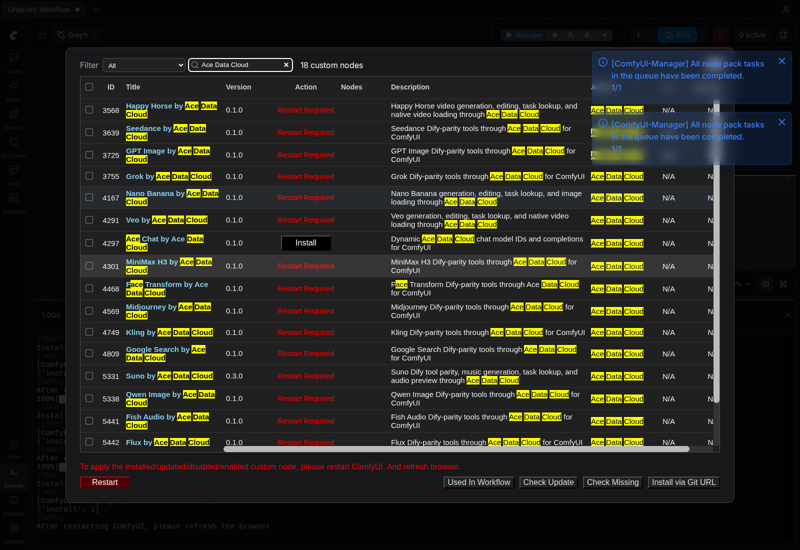
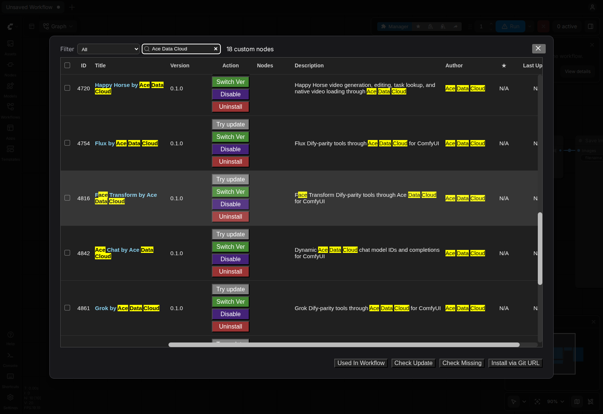

# Ace Chat for ComfyUI by Ace Data Cloud

Use a **dynamic model ID** with Ace Data Cloud's chat completions API from a ComfyUI graph. This package mirrors [ModelProviderDify](https://github.com/AceDataCloud/ModelProviderDify), whose model is configured by an exact ID rather than a finite selector. A read-only node lists the IDs currently returned for your Ace key. Chat completions may consume Credits at the [current model price](https://platform.acedata.cloud/models?utm_source=comfyui&utm_medium=referral&utm_campaign=evergreen&utm_content=acechatcomfyui_readme_en_pricing).

[简体中文](docs/README.zh-CN.md) · [Ace Data Cloud](https://platform.acedata.cloud?utm_source=comfyui&utm_medium=referral&utm_campaign=evergreen&utm_content=acechatcomfyui_readme_en_home) · [Issues](https://github.com/AceDataCloud/AceChatComfyUI/issues)

| Node | Purpose |
| --- | --- |
| **Ace Chat List Models** | Read `/v1/models` and optionally filter IDs; no chat generation |
| **Ace Chat Completion** | Send one non-streaming `/v1/chat/completions` request using an exact model ID |

The chat node returns assistant text, tool calls JSON, usage JSON, response ID, and response model as standard ComfyUI strings. `model_id` is free text so newly available IDs are not blocked by a stale package enum. The model list can include IDs that use another API surface; choose a chat-compatible ID and check its current access and price. The node returns function tool calls but does not execute those functions.


## Current version and install source

This source version is **0.1.1**. Check [GitHub Releases](https://github.com/AceDataCloud/AceChatComfyUI/releases) for its versioned ZIP. The Registry section below retains the last verified **Active 0.1.0 on 2026-10-19**; that older ZIP does not contain this release's updated guide, examples or fixes. To use this version, install its GitHub Release ZIP, or select the exact **0.1.1** Registry release once it becomes Active. Do not substitute the initial nightly selection for a verified stable release.

To install the GitHub ZIP, stop ComfyUI and back up any existing node directory. Extract the ZIP contents into `ComfyUI/custom_nodes/ace-chat/` without adding an extra nested directory, run `python -m pip install -r requirements.txt` there, then restart and refresh. Keep the API Token in the actual launch-process environment. A GitHub ZIP install is separate from a verified Registry/Manager stable installation.

## Install

Open the official [Ace Chat by Ace Data Cloud Registry page](https://registry.comfy.org/nodes/ace-chat), or search **Ace Chat** in **Manager → Custom Nodes Manager**. Verify the exact Ace publisher/repository below; use **Ace Data Cloud** as a fallback if the service spelling does not return it. Select **Ace Chat by Ace Data Cloud**, confirm publisher **acedatacloud** and source repository [`AceDataCloud/AceChatComfyUI`](https://github.com/AceDataCloud/AceChatComfyUI), then click **Install**. In **Select Version**, explicitly select the approved Registry stable release **0.1.0**. The normal dialog may initially highlight **nightly**; do not accept it for this stable-release tutorial. Keep dependency installation enabled. After **Restart Required**, restart ComfyUI and refresh the browser. Registry ID: `ace-chat`.





These are real **2026-10-16 Linux ComfyUI0.41.0** brand-search/installed-state screenshots, not a new service-term search or a paid request. See [sources and limits](docs/screenshot-sources.json).

This Registry stable installation was verified on **2026-10-16 with original ComfyUI 0.41.0 on Linux CPU**. That test did not submit a generation or chat request. Newer host versions and each paid action require their own checks; model availability and price remain subject to the current service rules.

For optional local source testing:

```bash
cd /path/to/ComfyUI/custom_nodes
git clone https://github.com/AceDataCloud/AceChatComfyUI.git
cd AceChatComfyUI
python -m pip install -r requirements.txt
```

Restart ComfyUI and search for **Ace Chat**.

## Set your key

### Copy or create your API Token

Sign in/register and initialize **Applications → General application** if needed. Copy an existing permitted API Token, or use **Manage Keys → Create** for a dedicated `ComfyUI` key. Check service access, expiry/Allowed APIs, Credits balance and current price first.


These masked **2026-10-08** Ace Console images are reused from SunoDify. The sample name `Dify tutorial` should be `ComfyUI` here; no credential was created for this guide. Configure only the Token string in the **actual process that launches ComfyUI** (`ACEDATACLOUD_API_KEY`), then restart. There is no Key widget in these nodes; never paste it into a prompt, JSON parameter, workflow or screenshot. An export in another terminal does not configure an already-running Desktop process.

1. Sign in to [Ace Data Cloud → Applications](https://platform.acedata.cloud/console/applications?utm_source=comfyui&utm_medium=referral&utm_campaign=evergreen&utm_content=acechatcomfyui_readme_en_api_key). If your account has no General application, choose **Initialize General Application**.
2. Open **General application** and check access to the service used by this package. A service-specific application key is limited to that service. Copy an existing API key, or choose **Manage Keys → Create** for a separate key named `ComfyUI`.
3. Copy only the token string, without `Bearer ` or quotation marks. A platform management token is not the API key these nodes use. If you enable **Allowed APIs**, include every submission and task-query path used by your workflow. Check current pricing and available Credits before a paid action.

Set an Ace key with chat access in the **actual ComfyUI process environment**, then restart:

```bash
export ACEDATACLOUD_API_KEY='paste-your-key-here'
python main.py --cpu
```

`ACEDATACLOUD_API_TOKEN` is also accepted. Keep the key out of workflows, screenshots, issues, and the repository. If you restrict API paths, allow `/v1/models` and `/v1/chat/completions`.

## Choose a model and chat

Import [01-list-models.json](examples/01-list-models.json) with **File → Open** and run it. This is a read-only request. Copy an exact chat-compatible ID into **Ace Chat Completion**. The Dify provider uses the same fixed `/v1` endpoint and a customizable model ID; this ComfyUI node follows that contract. The model list can change without a package release.

Import [02-chat-completion.json](examples/02-chat-completion.json), check the selected model's price, and run **once**. The example is a paid-call template. `prompt` plus optional `system_prompt` creates a simple conversation. `messages_json` can instead contain a full nonempty JSON message array; when present it takes precedence over those two fields. `tools_json` can provide an OpenAI-compatible function tool array. A temperature of `-1` omits the parameter and uses the model default; `max_tokens` limits output.

If the paid request times out, inspect Ace request history before another run. The node does not automatically retry chat submissions. To inspect current usage, use the [Ace Data Cloud Console](https://platform.acedata.cloud/console/applications?utm_source=comfyui&utm_medium=referral&utm_campaign=evergreen&utm_content=acechatcomfyui_readme_en_api_key). See [privacy notes](docs/PRIVACY.md).

## Troubleshooting

| Symptom | Action |
| --- | --- |
| Missing Key /401 | Configure the actual ComfyUI launch-process API Token and restart; a platform management Token is not an API Key. |
| 403 | Read the returned reason and check service entitlement, allowed paths, expiry or content restriction; do not blindly resubmit. |
| 429 | Wait for rate limits; keep any accepted task ID and avoid duplicate paid submissions. |
| Invalid JSON/model/input | Correct the named field according to the tool table; `{}`/example URLs are placeholders, not a complete paid request. |
| Submit timeout/5xx | Inspect request history/trace ID before another paid submission. |
| Unexpected result or media failure | Follow this service's synchronous/async section, confirm a completed real media URL where supported, and inspect Console. No result is fabricated from pending status. |

## Development

```bash
python -m unittest discover -s tests -v
python -m py_compile __init__.py client.py nodes.py
```

`pyproject.toml` declares Registry ID `ace-chat`, publisher `acedatacloud`, and a 400×400 proportional resize of the [canonical Ace logo](https://cdn.acedata.cloud/assets/logo.png).

Model listing is a read-only endpoint, but this version can cache identical graph inputs. Change `filter_text` when you explicitly need a fresh list. Do not change chat inputs merely to refresh a list, as that can create a new paid completion. Disable auto-queue before paid chat workflows.
